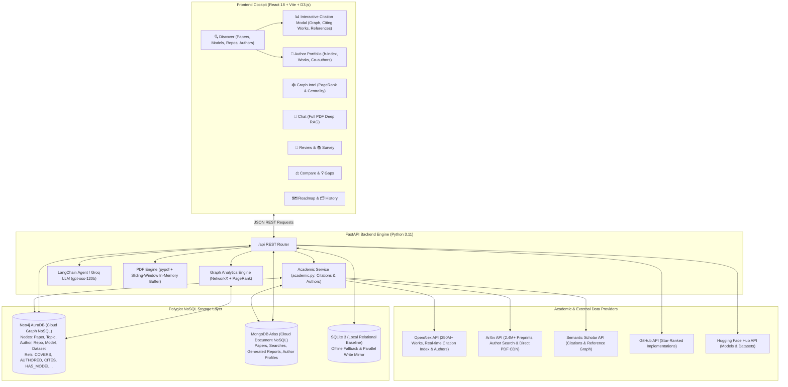

# ⚗️ ResearchIQ — Comprehensive System & Architectural Report

**Author & Creator:** Bharath ([GitHub Repository](https://github.com/Bharath-vinayagam/researchiq.git))  
**Platform Version:** 2.1 (Interactive Citation Explorer & Author Portfolio Search Edition)  
**Date:** October 2026  
**Status:** Operational, Connected, & Verified  

---

## 1. Executive Summary

**ResearchIQ** is an advanced academic and artificial intelligence research intelligence platform designed to replace fragmented literature workflows. Traditional research discovery relies on keyword searches across isolated portals, leaving researchers to manually track citations, read lengthy PDFs to find specific formulas, locate open-source implementations on GitHub, and find corresponding model weights on Hugging Face.

ResearchIQ unifies the entire scientific discovery lifecycle into a single interactive intelligence cockpit powered by:
1. **Live Model Context Protocol (MCP) & Academic Ingestion** (ArXiv, Semantic Scholar, OpenAlex, GitHub, Hugging Face Hub).
2. **Interactive Citation & Reference Explorer** (1-click citation graphs, incoming citing works, outgoing references, and Neo4j graph traversal).
3. **Author & Researcher Portfolio Engine** (Author discovery, h-index, cumulative citation analytics, institutional affiliations, and co-authorship graphs).
4. **Tri-Engine Polyglot NoSQL Architecture** (Neo4j AuraDB Graph + MongoDB Atlas Document Store + SQLite Relational Baseline).
5. **In-Memory Full PDF Deep RAG** with sliding-window chunking and exact page-level citations (`[Page 5]`).
6. **Graph Centrality & Algorithmic Analysis** (PageRank, Betweenness Centrality, HITS Authorities, Modularity Community Detection).
7. **Generative Research Agents** (Automated Literature Reviews, Systematic Surveys, Gap Detection, Architecture Comparison, and Milestone Learning Roadmaps).

---

## 2. Complete Architecture & System Data Flow

---

## 3. Core Engine Implementations

### A. Interactive Paper Citation & Reference Explorer (New in v2.1)
Academic papers cannot be understood in isolation; understanding their impact requires examining **who they cite** and **who cites them**.

Located in `backend/app/services/academic.py` and `frontend/src/components/CitationModal.jsx`:
1. **1-Click Citation Trigger:** Every paper card across Topic Search, Author Search, and Survey views provides a prominent **`📊 Citations & Network`** action badge.
2. **Multi-Source Citation Resolution:**
   - Queries OpenAlex's real-time citation index (`cites:W...`) for comprehensive incoming citations and referenced works.
   - Seamlessly queries Semantic Scholar API for academic metadata.
   - Traverses local Neo4j graph relationships (`MATCH (c:Paper)-[:CITES]->(p:Paper)`).
3. **Interactive D3 Citation Graph:** Generates a directed force simulation displaying:
   - 🟢 **Green Root Node:** The inspected paper.
   - 🔴 **Red Nodes:** Citing Papers (incoming influence).
   - 🔵 **Blue Nodes:** References (outgoing foundational references).
4. **Detailed Categorized Inspection:**
   - **Citing Papers Tab:** Direct listing of high-impact follow-up papers with publication year, authors, and citation counts.
   - **References Tab:** Complete bibliography of prior works cited by the author.
5. **Continuous Graph Ingestion:** Newly discovered citation edges are persisted into Neo4j AuraDB (`save_citations_to_neo4j`), continuously densifying the local research knowledge graph.
6. **Clickable Author Shortcuts:** Every author in the paper header or citation lists is a clickable chip, enabling 1-click drill-down into the author's research portfolio.

---

### B. Author & Researcher Portfolio Engine (New in v2.1)
Finding the top researchers in a domain and evaluating their complete body of work is a primary research requirement.

Located in `backend/app/services/academic.py` and `frontend/src/pages/Discover.jsx`:
1. **Dual-Mode Discovery Cockpit:** A top toggle enables switching between:
   - `[ 📄 Search by Topic / Title ]`
   - `[ 👤 Search by Author / Researcher ]`
2. **Author Profile Hero Card:**
   - Researcher name and verified academic institutions/affiliations (e.g. *University of Southern California*, *Google*, *University of Toronto*).
   - Cumulative citation metrics across all works.
   - **h-index** badge quantifying research productivity and citation impact.
   - Direct ORCID link integration.
3. **Research Papers Portfolio:**
   - Complete list of publications authored by the researcher.
   - Dynamic sorting by **Most Cited** (highest impact) or **Newest (Year)** (latest preprints).
   - Each paper includes full abstract, co-author list, and direct access to the `📊 Citations & Network` modal.
4. **Frequent Co-Authors & Collaborators:**
   - Grid of primary collaborators with joint publication counts.
   - 1-click **"View Papers →"** button to jump directly to that collaborator's portfolio.
5. **Collaboration Knowledge Graph:** D3 graph placing the researcher in gold (`#e3b341`) at the center, linked to their top papers (gray) and frequent co-authors (orange).
6. **Universal Cross-Navigation:** Clicking any author name in ANY paper card across the entire application immediately opens their full research portfolio.

---

### C. Tri-Engine Polyglot NoSQL Architecture
Research data is inherently multi-modal: papers have document metadata, citation networks form complex directed graphs, and application logs require lightweight relational persistence. ResearchIQ resolves this with a tri-engine architecture:

| Database Engine | Type | Primary Role & Schema |
|---|---|---|
| **Neo4j AuraDB** | Graph NoSQL | Models scientific topology. Nodes: `Paper`, `Topic`, `Author`, `Repository`, `Model`, `Dataset`. Relationships: `COVERS`, `AUTHORED`, `CITES`, `HAS_IMPLEMENTATION`, `HAS_MODEL`, `USES_DATASET`. |
| **MongoDB Atlas** | Document NoSQL | High-throughput JSON document storage for raw paper payloads, multi-section survey reports, gap analyses, and search query logs. |
| **SQLite 3** | Relational | Zero-configuration local persistence ensuring the application remains 100% functional even when offline, serving as a parallel write mirror. |

> [!NOTE]
> All database connections feature **hot-reloading configuration** and **graceful fallback** — if any cloud database experiences network latency, the platform seamlessly fails over to the next storage layer without throwing user-facing errors.

---

### D. "Chat with the Full PDF" (Deep Paper RAG)
Traditional RAG systems only index brief paper abstracts, missing detailed formulas, hyperparameters, experimental setups, and benchmark tables.

ResearchIQ implements an **In-Memory Full-Text PDF Engine** (`pdf_engine.py`):
1. **Direct ArXiv Binary Fetch:** `download_arxiv_pdf(arxiv_id)` directly streams the raw binary `.pdf` from ArXiv's CDN into an in-memory `io.BytesIO` buffer.
2. **Zero Disk Leak:** No temporary PDF files are stored on local hard drives.
3. **Sliding-Window Semantic Chunking:** Slices full paper text into 700-character windows with 120-character overlapping boundaries to avoid cutting mathematical derivations across chunk margins.
4. **Page Number Metadata Tagging:** Every chunk retains its exact 1-indexed document page number (`page: 5`, `paper: 1706.03762.pdf`).
5. **BM25 Sub-Linear Length-Normalized Retrieval:** Fast in-memory token scoring ranks the top 6 most relevant chunks for any question.
6. **Page-Grounding Prompting:** Prompts the Groq LLM to answer strictly from verified excerpts and tag every claim with `[Page X]` citations, which the frontend renders as styled badges (`📄 Page 5`).

---

### E. Graph Algorithms & Centrality Engine
Located in `backend/app/analytics/graph_analytics.py`, this engine performs rigorous graph-theoretic calculations over the citation and knowledge graph:

1. **PageRank ($\alpha = 0.85$):**
   $$PR(p) = \frac{1-d}{N} + d \sum_{q \in In(p)} \frac{PR(q)}{Out(q)}$$
   Measures recursive prestige. A paper cited by another seminal, highly cited paper receives an exponentially higher score than a paper cited by obscure preprints.
2. **Betweenness Centrality:**
   $$g(v) = \sum_{s \neq v \neq t} \frac{\sigma_{st}(v)}{\sigma_{st}}$$
   Pinpoints "bridge papers" that connect disparate sub-fields (e.g. bridging deep learning and clinical medical diagnosis).
3. **In-Degree Centrality:** Measures raw direct citation density within the knowledge graph.
4. **HITS (Hubs & Authorities):** Differentiates cornerstone foundational papers (Authorities) from comprehensive survey papers that cite the entire field (Hubs).
5. **Greedy Modularity Community Detection:** Automatically groups papers into semantic clusters/sub-disciplines without requiring manual labels.
6. **Author Prestige Aggregation:** Propagates paper centrality across `AUTHORED` edges to rank the most influential researchers in a domain.
7. **Neo4j AuraDB Write-Back:** Writes the computed `pagerank`, `betweenness`, and `community` properties back into the `(p:Paper)` nodes in Neo4j AuraDB with a single click (`POST /api/graph/sync_metrics`).

---

### F. Hugging Face Hub MCP (Models & Datasets)
Located in `backend/app/mcp/huggingface.py`, this module extends scientific research into the realm of real-world AI artifacts:
- **Models API:** Queries the official Hugging Face Hub API for open-weights models matching any research topic, sorted by download volume.
- **Metadata Extraction:** Returns model author/organization, task pipeline tag (`text-generation`, `image-to-image`), likes, download metrics, and tags.
- **ArXiv Paper Cross-Referencing:** Parses tags matching `arxiv:XXXX.XXXXX` to link the model directly back to the academic paper.
- **Datasets API:** Discovers benchmark evaluation datasets and training corpora.
- **1-Click Python Snippet:** Frontend generates complete `from transformers import AutoModelForCausalLM...` code snippets ready to copy into Python scripts.
- **Graph Ingestion:** Ingests `(m:Model)` and `(d:Dataset)` nodes into Neo4j AuraDB, linked to the topic via `[:HAS_MODEL]` and `[:USES_DATASET]`.

---

## 4. Platform Capability & Feature Matrix

| Feature | Navigation Tab | Engine / Tech Stack | Primary User Outcome |
|---|---|---|---|
| **Research Paper Discovery** | `🔍 Discover` | ArXiv + Semantic Scholar + GitHub + Hugging Face + D3.js | Comprehensive exploration across 4 data providers, showing papers, models, datasets, and code in 4 dedicated tabs. |
| **Interactive Paper Citations** | `🔍 Discover` / Modal | OpenAlex + Semantic Scholar + Neo4j + D3.js | 1-click citation modal showing interactive citation graph, incoming citing papers, and reference bibliography. |
| **Author Portfolio Search** | `🔍 Discover` (Author Mode) | OpenAlex + ArXiv + Neo4j + D3.js | Discovers researcher h-index, affiliations, total papers, co-authors, and collaboration graphs. |
| **Graph Intelligence** | `🕸️ Graph Intel` | Neo4j AuraDB + NetworkX + D3.js Force Simulation | Interactive prestige map with dynamic node sizing, 4 centrality algorithms, top papers leaderboard, top researchers leaderboard, and live Neo4j write-back. |
| **Literature Review Synthesis** | `📖 Review` | Groq LLM (`gpt-oss-120b`) + LangChain + MongoDB | Generates an executive literature review synthesizing state-of-the-art papers, core methods, and findings with Markdown export. |
| **Structured Paper Survey** | `📚 Survey` | Groq LLM + Neo4j Graph + NetworkX | Multi-section academic survey with taxonomy, timeline, research gaps, interactive knowledge graph, and Markdown export. |
| **Research Gap Detector** | `💡 Gaps` | Groq LLM + Vector Store RAG | Scans recent literature to identify unsolved limitations, open challenges, and high-impact future research avenues. |
| **Head-to-Head Comparison** | `⚖️ Compare` | Groq LLM Comparative Reasoning | Side-by-side comparison matrix breaking down methodology, datasets, benchmark results, and trade-offs. |
| **Full PDF Deep RAG Chat** | `💬 Chat` | `pypdf` + Sliding-Window In-Memory Store + Groq LLM | Page-grounded Q&A against any local uploaded PDF or ArXiv ID with exact `📄 Page X` citations and excerpt inspection. |
| **Milestone Learning Roadmap** | `🗺️ Roadmap` | Groq LLM + Structured JSON Parsing | 4-Phase milestone curriculum breaking complex subjects into foundations, methods, advanced topics, and contributions. |
| **Multi-Cloud Research Archive** | `🗂️ History` | MongoDB Atlas + SQLite 3 | Dual-cloud persistent storage allowing researchers to search, view, and export all generated reports and searches. |

---

## 5. Complete REST API Reference

| Method | Endpoint | Description |
|---|---|---|
| `POST` | `/api/search` | Multi-source search across ArXiv, Scholar, GitHub, and Hugging Face; persists graph to Neo4j. |
| `POST` | `/api/citations` | Fetches incoming citing papers, outgoing references, and citation graph via OpenAlex, Scholar, & Neo4j. |
| `POST` | `/api/author/search` | Searches researcher portfolio, h-index, affiliations, authored papers, and co-authors. |
| `GET` | `/api/author` | Fetches researcher profile and publications by author name query parameter. |
| `POST` | `/api/review` | Generates structured Literature Review and saves to MongoDB & SQLite. |
| `POST` | `/api/survey` | Generates multi-section academic survey with knowledge graph. |
| `POST` | `/api/gaps` | Analyzes papers on a topic to extract open research gaps. |
| `POST` | `/api/compare` | Evaluates two papers side-by-side across methodology and datasets. |
| `POST` | `/api/roadmap` | Generates 4-phase structured research learning path. |
| `POST` | `/api/chat` | Global multi-paper RAG chat using collected literature. |
| `POST` | `/api/pdf/upload` | Uploads and indexes a local `.pdf` file in memory with sliding-window chunking. |
| `POST` | `/api/pdf/fetch_arxiv` | Downloads and indexes a full PDF directly from ArXiv by ID. |
| `POST` | `/api/pdf/chat` | Queries the in-memory PDF chunk store and returns page-cited answers. |
| `GET` | `/api/pdf/status` | Returns loaded paper name, page count, and chunk count. |
| `DELETE`| `/api/pdf/clear` | Clears active PDF memory store. |
| `GET` | `/api/graph/analytics` | Computes PageRank, Betweenness Centrality, Communities, and D3 graph data. |
| `POST` | `/api/graph/sync_metrics` | Writes computed PageRank and Betweenness metrics directly into Neo4j AuraDB. |
| `GET` | `/api/hf/models` | Queries Hugging Face Hub for pretrained models matching a query. |
| `GET` | `/api/hf/datasets` | Queries Hugging Face Hub for benchmark datasets matching a query. |
| `GET` | `/api/neo4j/status` | Returns live connection status, URI, and node/relationship counts for Neo4j AuraDB. |
| `GET` | `/api/mongodb/status` | Returns live connection status and document counts for MongoDB Atlas. |
| `GET` | `/api/reports` | Fetches all persisted research reports from MongoDB / SQLite. |
| `GET` | `/api/searches` | Fetches past search queries and results. |

---

## 6. Security, Compliance, & Zero-Disk Design

1. **Strict Credential Protection:**
   - All connection URIs, database passwords (Neo4j, MongoDB), and API keys (Groq, GitHub, Hugging Face) are isolated in `.env`.
   - `.env` is strictly ignored by `.gitignore` and has never been committed to source control.
2. **Zero Disk Leak / Memory Streams:**
   - PDF uploads and downloads stream through Python `io.BytesIO` in RAM. No temporary files linger on the host machine.
3. **Resilience & Zero-Downtime Fallback:**
   - Neo4j AuraDB failures gracefully fallback to in-memory NetworkX.
   - MongoDB Atlas latency gracefully falls back to local SQLite.
   - Citation engine seamlessly cascades through OpenAlex $\rightarrow$ Semantic Scholar $\rightarrow$ Neo4j local graph store.
   - Free Groq LLM tier uses `openai/gpt-oss-120b`, ensuring reliable quota and sub-second generation.
